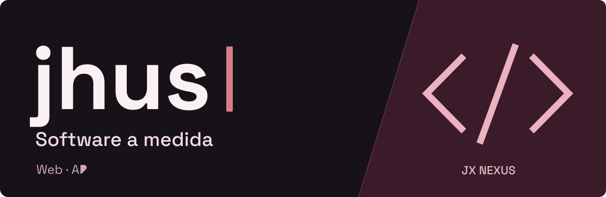

### Hola, soy jhus.

Desarrollo aplicaciones web y sistemas a medida, conectando interfaces, APIs y bases de datos. De una necesidad concreta a una herramienta útil.

### Tecnologías

   &nbsp;
   &nbsp;
   &nbsp;
   &nbsp;
   &nbsp;
   &nbsp;
  

`C# / .NET` · `React / Vite` · `PostgreSQL` · `Docker / Nginx`

### Lo que construyo

- **Sistemas de gestión** para organizar información y conectar procesos.
- **Aplicaciones web** con interfaces claras y lógica de negocio.
- **APIs e integraciones** para comunicar servicios y automatizar tareas.

  
Cómo trabajo

   
  Entender el problema, construir por etapas y comprobar cada avance. Doy prioridad a los permisos de acceso, la consistencia de los datos y un código que se pueda mantener.

 

&nbsp;

 
 

Mis proyectos se mantienen en repositorios privados.
