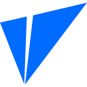
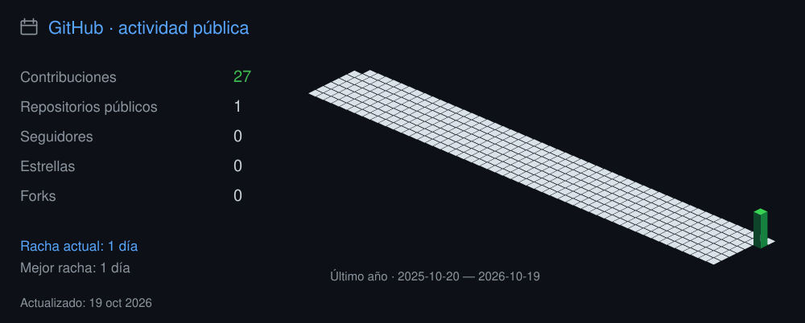
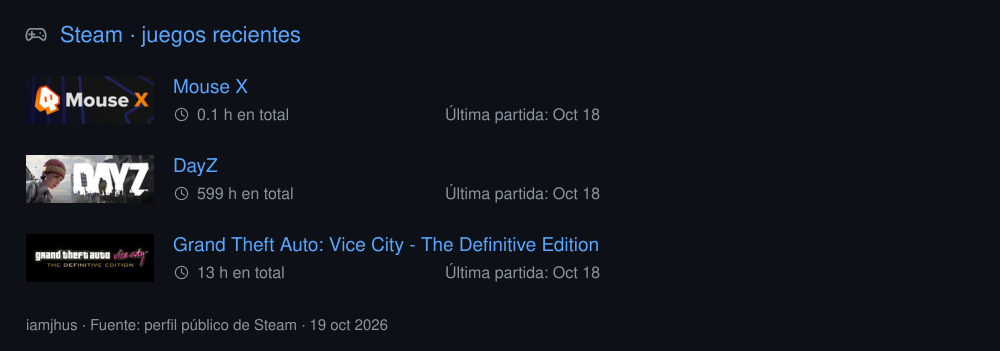

<picture>
  <source media="(max-width: 640px)" srcset="./assets/profile-terminal-mobile-consolas-v3.svg" />
  
</picture>

  <a href="#stack">Stack</a> &nbsp;·&nbsp;
  <a href="#actividad">Actividad</a> &nbsp;·&nbsp;
  <a href="#steam">Steam</a> &nbsp;·&nbsp;
  <a href="https://jxnexus.net/#contacto">Contacto</a>

### Stack

<b>Frontend</b> · React, Next.js, Astro, Angular, Vite

 &nbsp;
 &nbsp;
 &nbsp;
 &nbsp;

[React](https://react.dev/) · [Next.js](https://nextjs.org/docs) · [Astro](https://docs.astro.build/) · [Angular](https://angular.dev/) · [Vite](https://vite.dev/)

<b>Backend y lenguajes</b> · Node.js, Python, C#, .NET, Rust, C, C++

 &nbsp;
 &nbsp;
 &nbsp;
 &nbsp;
 &nbsp;
 &nbsp;

Node.js · Python · C# · .NET · Rust · C · C++

<b>Datos e infraestructura</b> · SQL Server, PostgreSQL, Docker, Nginx

 &nbsp;
 &nbsp;
 &nbsp;

SQL Server · PostgreSQL · Docker · Nginx

<b>Sistemas y plataformas</b> · Windows, Linux, macOS / iOS, Android

 &nbsp;
 &nbsp;
 &nbsp;

Windows · Linux · macOS / iOS · Android

### Actividad

Explorar el calendario anual

Explorar los últimos seis meses

### Steam

Mis juegos recientes

[Abrir mi perfil de Steam](https://steamcommunity.com/id/iamjhus/)

---

  <a href="https://jxnexus.net/">JX NEXUS</a> &nbsp;·&nbsp;
  <a href="https://jxnexus.net/#contacto">Hablemos de tu proyecto</a>

