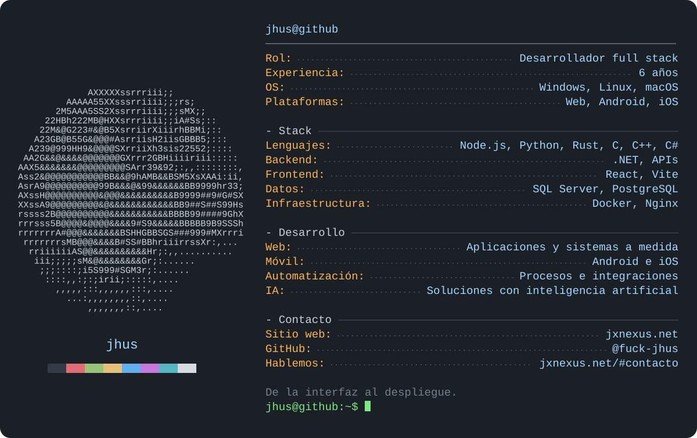

<picture>
  <source media="(max-width: 640px)" srcset="./assets/profile-terminal-mobile-v1.svg" />
  
</picture>

  <a href="https://jxnexus.net/">JX NEXUS</a> &nbsp;·&nbsp;
  <a href="https://jxnexus.net/#contacto">Hablemos de tu proyecto</a>

Sobre mí y tecnologías

Soy desarrollador **full stack con 6 años de experiencia**. Desarrollo aplicaciones web, Android e iOS, automatizaciones y soluciones con inteligencia artificial, desde la interfaz y las APIs hasta los datos y el despliegue.

- **Lenguajes y desarrollo:** Node.js, Python, Rust, C, C++, C#, .NET, React y Vite.
- **Datos e infraestructura:** SQL Server, PostgreSQL, Docker y Nginx.
- **Sistemas y plataformas:** Windows, Linux, macOS, Android e iOS.
- **Contacto:** [jxnexus.net](https://jxnexus.net/#contacto).

