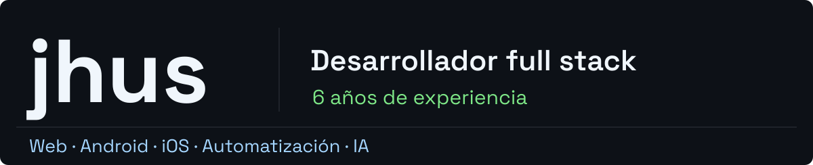
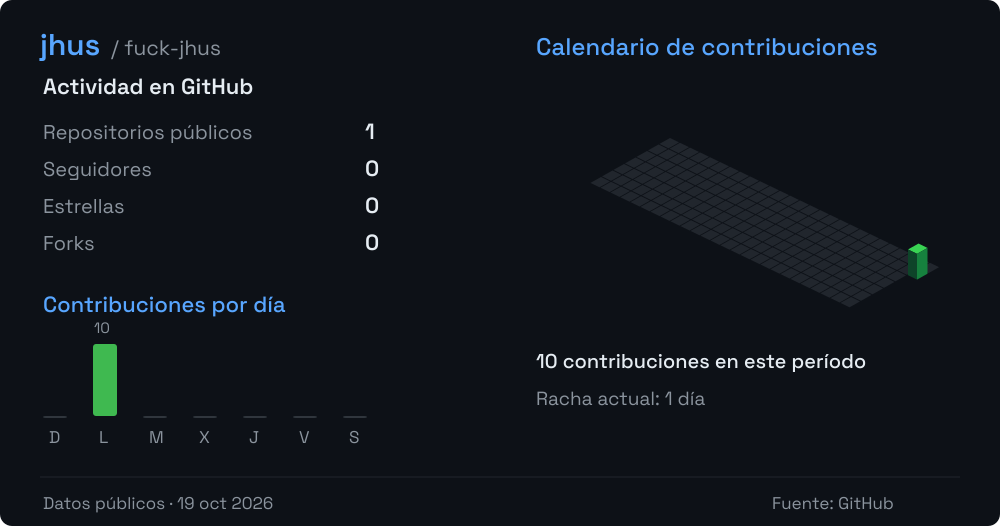

Soy desarrollador **full stack con 6 años de experiencia**. Desarrollo aplicaciones **web, Android e iOS**, automatizaciones y soluciones con **inteligencia artificial**, desde la interfaz y las APIs hasta los datos y el despliegue.

### Lenguajes y desarrollo

   &nbsp;
   &nbsp;
   &nbsp;
   &nbsp;
   &nbsp;
   &nbsp;
   &nbsp;
   &nbsp;
  

Node.js · Python · Rust · C · C++ · C# · .NET · React · Vite

### Datos e infraestructura

   &nbsp;
   &nbsp;
   &nbsp;
  

SQL Server · PostgreSQL · Docker · Nginx

### Sistemas y plataformas

   &nbsp;
   &nbsp;
   &nbsp;
  

Windows · Linux · macOS · Android · iOS

### Actividad en GitHub

<picture>
  
</picture>

La actividad corresponde a esta cuenta de GitHub; mi experiencia también incluye proyectos privados.

 
 

&nbsp;

